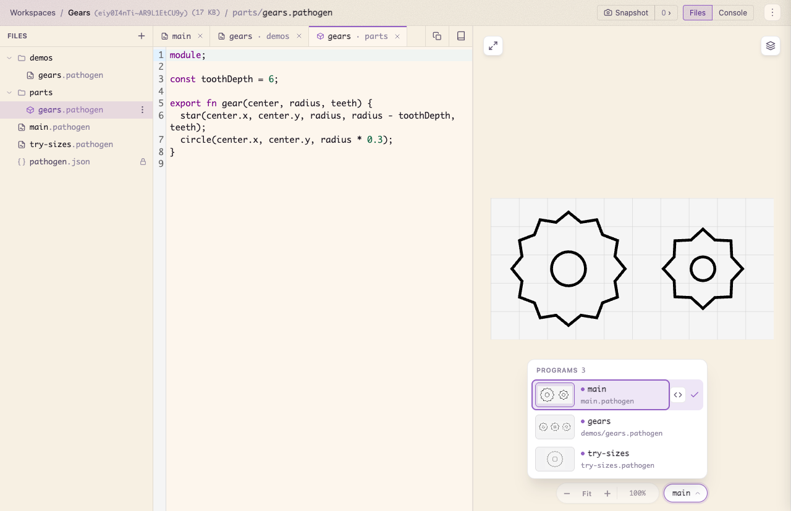

# Documentation

User-facing developer documentation — every `.md` file here is compiled into the published site at `/docs`.

## Scope: what belongs here vs `project-docs/`

This directory is **user-facing developer documentation**. Every file here is published to the website and forms the contract the end user sees. If content is **internal** (agent plans, feature primers, roadmaps, demo `.pathogen` files, decision logs, weekly summaries), it belongs in `project-docs/` instead — that directory is never published.

**`project-docs/` is not a substitute for `docs/`.** When adding a new Pathogen language feature, this directory is the **first** place to write — before `src/`, before tests, before any `project-docs/` artifact. See `src/CLAUDE.md` → Development Lifecycle step 1, and `.claude/CLAUDE.md` → [`docs/` vs `project-docs/`](../.claude/CLAUDE.md#docs-vs-project-docs).

## Overview

- Compiled by `scripts/build-docs.ts` via the `DOC_FILES` constant
- Outputs: `playground/utils/docs-content.js` (SPA) + `website/docs-static/index.html` (SEO)
- Heading IDs auto-generated with section prefix (e.g., `syntax-variables`)
- Build: `npm run build:docs`
- Plans, primers, and internal reference docs live in `project-docs/` (never published)

## Publishing

- **Documentation is written first** — before implementation. When adding, removing, or revising Pathogen language features, begin by updating the relevant docs to define the contract, then proceed to implementation. See `src/CLAUDE.md` for the full development lifecycle.
- **Important**: After creating a new `.md` file in `docs/`, add it to the `DOC_FILES` mapping in `scripts/build-docs.ts` or it will not be published
- Verify with `npm run build:docs` and `npm run check-links`
- **Agentic Review**: Agentic review and revision is required before committing or publishing documentation updates. Ensure that the user has viewed the critique, feedback, and roundtable synthesis, and that they have approved the documentation updates.

## Images

A page can show an image, such as a screenshot, written on a line of its own:

```markdown

```

- **The file** is a PNG in `docs/images/` (tracked; folders inside it are fine). Only PNG is supported: another format stops the build.
- **Alt text is required.** It says what the image shows, for people who can't see it.
- **A paragraph of its own,** with a blank line before and after it. An image in a sentence, a list, a table or a link stops the build, with a message that names the page and the image. The reference form (`![What it shows][ref]` with `[ref]: images/name.png`) works too.
- **A dark version** goes beside it as `workspace-files.dark.png`, the same size. The page shows the version for the theme (light, dark, or the system setting); without one, the same image shows in both.
- **What the build does** (`npm run build:docs`, `scripts/lib/doc-images.ts`):
  - checks every image;
  - gives it its width and height, so the page doesn't jump as it loads;
  - copies the ones published pages use to `website/docs-static/images/`, served at `/docs/images/`.

  A page not yet in `DOC_FILES` can hold images already, but the build doesn't render that page, so its images are checked only once it's registered. Until then the build lists them as not on a published page.
- **How it looks:** `playground/utils/doc-image-css.ts`, one string shared by the static docs page and the workspace's docs panel. The theme switch is `--doc-image-light` and `--doc-image-dark` in `playground/styles/theme.css`.
- **Checks:** `npm run check-links` checks that every image on the docs page loads as an image. `project-docs/docs-images/verify-doc-images.ts` checks the two places docs show, in every theme.
- **Screenshots of the playground go stale.** List each one in its page's header comment, with what it shows, so it's taken again when that part of the UI changes.

## Shared Content Guidelines

The following shared guidelines apply to documentation content:

- [Voice and Audience](../website/guidelines/voice-and-audience.md) — Audience definition and voice principles for all user-facing writing (applies to new writing only)
- [Code Example Guidelines](../website/guidelines/code-example-guidelines.md) — Standards for all embedded code examples
- [Example Design System](../website/guidelines/example-design-system.md) — Token-level design system (colors, typography, spacing, annotation patterns) for every example surface
- [Schematic and Diagram Checklist](../website/guidelines/schematic-and-diagram-checklist-plus-antipatterns.md) — Review checklist and anti-patterns for diagrams
- [Agentic Review Process](../website/guidelines/agentic-review.md) — Multi-persona review process (mandatory for all published content including documentation)
- [Text Collision Debugging](../website/guidelines/text-collision-debugging.md) — Rules for diagnosing and preventing text-vs-element collisions in diagrams
