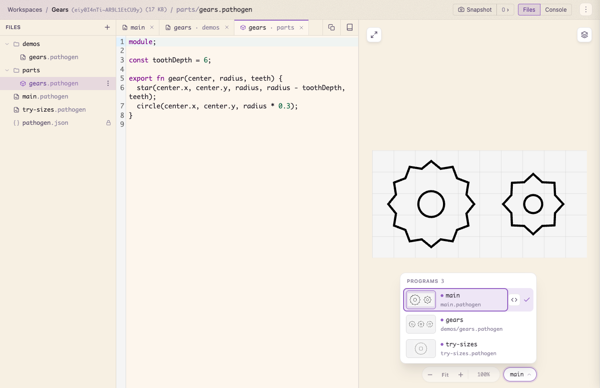

<!--
Published with phase 2e (2026-11; project-docs/modules/58-phase-2e-plan.md, step 7).
The screenshot (docs/CLAUDE.md "Images"): images/workspace-files.png and workspace-files.dark.png,
taken with 2e's UI: a workspace of several files, the tree open, files in tabs, and the program
chip's list open. Take both again whenever the workspace's layout, the tree, the tabs or the program
list change (step 10's review, finding 17).
Downloading a workspace and making one from a project came with 2g (the lines at the end of this comment).
When data files and fonts can be added (after phase 2): Limits gains data files 5 MB each, fonts
20 MB each (note 50), and the 50 MB whole-workspace row, which 20 files of 1 MB can't reach today.
Sources: mockups v1 to v6 and their reviews (project-docs/modules/39- to 46-).
The [TO CONFIRM] items (undo per file, clicking an error to open its file, a moved file's own
imports, folder Rename/Delete, Duplicate's naming) were confirmed 2026-11-09 (note 52). Limits and
name characters: decided in note 50. Copy URL leaves the playground with this page (note 52).
The mockup v7 answers (2026-11-09, note 53) are folded in: the first program in an empty
workspace is shown; the thumbnail while nothing draws; Undo after a rename or move; Rename
changes the name only, and Move to… moves; "On a phone".
The mockups v8 to v11 answers (2026-11-12, notes 54 to 57) are folded in: every tab can close; with
none open, the editor's zero-state opens the main (or offers New program with no program); the
preview has no zero-state of its own; Copy Code and Format Document wait for a file.
Approved 2026-11-12 (note 52): the Undo sentence under "Renaming, moving and deleting" (the
import rewrites stay out of each file's undo history, as built in 4c-2), and the status with no
program reads "No programs", as the Workspaces page does.
Agreed 2026-11-13 (note 52, step 5a): the program shown becoming a module sends the preview back
to the main; Set Thumbnail's reasons "Show the main first" and "The main is a module now".
Decided 2026-11-13: a file with `module;` is a "module" everywhere in the UI and docs, never a
"library" (the keyword's own name; note 52).
Agreed 2026-11-13 (note 52, step 5b): the dot shows only while the file you're editing isn't the
program shown (the mockup's rule); a blank tile says why on hover ("Too detailed to draw this small").
Answered 2026-11-13 (note 52, step 6a): a name that doesn't fit is changed to fit (dashes, accents
dropped); the limit refuses a whole upload; files over 1 MB or not text are left out; dot-files
without a mention; the upload's message has Undo; Esc skips; a dropped folder's empty folders are
kept; a folder differing only in case goes into the one there.
Answered 2026-11-13 (note 52, step 6b): the upload's label counts what's dragged (the browser hides
the names until the drop); a whole upload goes in after the last question ("This is fine").
Agreed 2026-11-13 (note 52, step 7): every error under its file, with links; the console's links;
the note's words and its link to Set as main; the dots' hover texts; Cmd+click on an import's path;
a folded folder's dot.
Answered 2026-11-13 (note 52, step 8; note 42's five questions): Copy Debug Info carries the program
shown and the files its imports reach; 200 lines a file, about 1,500 in all; other programs' errors
with five lines either side ("Could we include a bit more context"); both places it's offered; a
short note for an assistant that names no syntax and points to the docs.
Built 2026-11-13 (note 52, step 9a): with no program, Snapshot waits too (v7 draws it off), and the
four reasons start "Add a program first".
Step 10 (2026-11-13): the final content review of the whole page, findings applied
(project-docs/modules/reviews/phase-2d-step10-docs-review.md). Which program Export and Copy SVG
take is stated as built, the program the preview shows (your answer: "Sounds good for now. We can
spend more time during 2g").
Reordered 2026-11-14 ("go ahead and apply the review fixes"), as the review's finding 5 proposed:
pathogen.json now follows the program list and Try it, and a new "When the main is gone or can't
draw" after it holds deleting the last program and a main that's a module. Its content review's
five findings are applied (step 10's review record, "After your go-ahead").
Phase 2g (2026-11-23, notes 67 to 69, mockups v1 and v2 approved): "Not yet" goes. Download
workspace in the ⋮ menu (the name is the owner's: "Export implies a transformation"; small text
"A .zip of every file"); a new workspace from a project folder or a .zip on the New Workspace page;
Export, Copy SVG and Snapshot name the program they take. The import stops when pathogen.json can't
be read (the CLI's parse checks), and drops an entryPoints entry it can't use (note 69's rule).
Phase 3a (2026-11-23, note 72; DRAFT, awaiting the mockup round and approval): data files (JSON and
text) in a workspace: the Data files section, uploads, New data file, the limits (5 MB a data file,
50 MB a workspace, data files count toward the 20), errors, Copy Debug Info, downloads and imports.
Revised 2026-11-24 (note 74, the first mockup round's answers): JSON only, text (.txt) on hold;
New data file… opens a dialog for the name and the type, and a new file starts as {}; a refused
save says why in the error panel, not in the breadcrumb or a toast. The dialog made lighter
2026-11-24 (note 75, mockups v3): one field, the name and the extension as a dropdown after it.
Every refused save, a .pathogen file over 1 MB too, says why in the error panel (note 75).
-->


# Files in a Workspace

> **Prerequisites:** This page assumes you know what `import`, `export` and `module;` do ([Modules](#modules-importing)), and what a project folder and its `pathogen.json` are ([Projects and Files](#projects-the-project-folder)).

A workspace can hold several files: programs that draw, modules they import, and data files they read. It works like a project folder in the CLI or VS Code, with the same `import` paths and the same `pathogen.json`, so a workspace and a folder on your computer have the same shape.

Three parts work together. The **tree** lists the files. The **editor** shows the file you open, in tabs. The **preview** shows one program; with several, the program chip beside its zoom controls chooses which. So you can edit a module while the preview keeps showing a program that uses it, redrawn as you type.



To take a workspace to the CLI or VS Code, download it as a project folder ([Downloading a workspace](#workspace-files-downloading-a-workspace)). To bring a project folder in, make a new workspace from it ([A workspace from a project](#workspace-files-a-workspace-from-a-project)).

> **What changed (November 2026):** A workspace you made before now holds one program, `main.pathogen`, with its code unchanged, and a `pathogen.json` beside it. It draws as before, and so do its snapshots and its public page. **Copy URL** is gone from the workspace's menu, since a link could only hold one file; a link copied before still opens.

## A new workspace

A new workspace holds one program, `main.pathogen`, and `pathogen.json`, a project file the playground writes for you, which lists the workspace's programs with the main first ([below](#workspace-files-pathogenjson)). With one program, the preview shows it, as before. A new workspace can also start from a project folder or a `.zip` ([A workspace from a project](#workspace-files-a-workspace-from-a-project)).

## The file tree and tabs

- **Files**, beside Console in the breadcrumb, shows or hides the tree. Folders come first, then files.
- The tree shows each file's full name. Programs, modules and [data files](#workspace-files-data-files) have different icons.
- Each file and folder has its own menu: its ⋮ (shown when you hover the row), a right-click, or the menu key. The workspace's own menu is the ⋮ at the right end of the breadcrumb.
- Click a file to open it in a tab. Tab labels leave out `.pathogen`; a data file's tab keeps its extension, as `gears.json`. When two open files share a name, each tab adds its folder: `gears · parts` and `gears · demos`.
- A tab's **×** closes it, and so does a middle-click. You can close every tab. Opening the workspace again opens [the main](#workspace-files-the-main).
- With no tab open, the editor offers to open the main, or you can click any file in the tree. In a workspace with no programs, it offers **New program** instead.
- The book at the right end of the tabs shows or hides the docs.
- The breadcrumb names the open file with its folder: `parts/gears.pathogen`.
- **Cmd+click** (Ctrl+click on Windows and Linux) a name you imported to open the file it comes from, at its declaration. Cmd+click an import's path, or a `* as` name, to open that file at its top.
- Each file keeps its own undo history while the workspace is open, even after its tab is closed.
- The **copy icon** at the end of the tabs, before the book, copies the file in the editor; its tooltip names the file. With no file open, it isn't there, and **Format Document** in the workspace's menu is off.

## Programs and modules

- A file that starts with `module;` is a **module**. It holds fns, consts and enums for other files to import, and it never draws (see [Modules](#modules-exporting)).
- Every other `.pathogen` file is a **program**. Any program can be shown in the preview.

## Data files

A workspace can hold data files beside its programs: JSON files (`.json`, `.geojson`, `.topojson`, `.fold`). A program imports one by a name, as in the CLI: `import gears from "./data/gears.json";` ([Data Imports](#data-import-data-imports)).

- **A data file opens in the editor,** where you edit it as text. JSON is highlighted, and a mistake in it is underlined as you type, with the message the import would give.
- **Editing a data file redraws** every program that imports it, as editing a module does, and the program list's dots mark those programs. While the file has a mistake, those programs show the error ([Errors in other files](#workspace-files-errors-in-other-files)) and the preview keeps its last drawing.
- **New data file…**, in the **+** menu and in a folder's menu, opens a dialog with one field: the file's name, and after it the extension, `.json` unless you choose another.
  - Type a name, such as `trips`. Adding to `data/`, the line under the field reads `Adds data/trips.json`. A slash makes folders, as for a program.
  - Click the extension to choose another: `.json`, `.geojson`, `.topojson` or `.fold`. The list says what each one holds, such as "GeoJSON: places and shapes on a map". Typing `trips.geojson` in the name chooses `.geojson` too.
  - If the name is taken, ends in an extension that isn't one of the four, breaks the [rules for names](#workspace-files-adding-files-and-folders), or the workspace already holds 20 files, the dialog says why, as in `data/ already has trips.json.`, and Create is off.
  - **Create** (or Enter) makes the file, starting as `{}`, and opens it. Esc cancels.
- **Upload files…** and dragging onto the tree add data files as they add programs ([Uploading files](#workspace-files-uploading-files)).
- **Format Document** is off while a data file is open: it formats Pathogen code.
- **A data file can be up to 5 MB,** and a workspace up to 50 MB and 20 files, data files included. If an edit would take the file or the workspace past a limit, it isn't saved: the save status reads "Not saved", and the error panel at the bottom of the editor says why. Your edits stay in the editor ([Limits](#workspace-files-limits)).

## The main

The workspace's **main** is the program it opens on, the one its thumbnail shows, and the one [publishing](#workspace-files-snapshots-copies-and-publishing) uses. It's `main.pathogen` unless you choose another.

- **Set as main**, in a program's menu in the tree, makes it the main. A main that isn't `main.pathogen` has a `main` badge in the tree and in the program list (the chip's list, [below](#workspace-files-the-preview-and-the-program-list)).
- Setting the main doesn't change what the preview shows.
- The thumbnail is taken from the preview, so **Set Thumbnail** works while the preview shows the main. With another program shown, it's off and says "Show the main first".
- Renaming the main keeps it the main.
- **Deleting the main** makes the next program in `pathogen.json`'s list the main, and a message says which. After a Set as main, that's the program that was the main before.
- **Deleting the last program**, or **adding `module;` to the main**, leaves no main that draws: see [When the main is gone or can't draw](#workspace-files-when-the-main-is-gone-or-cant-draw).

## The preview and the program list

With more than one program, a chip beside the zoom controls names the program the preview shows. Click it for the **program list**: each program with a small drawing, its name and its path. A check marks the one shown. The main comes first, then the others in `pathogen.json`'s order. New programs join at the end, and **Set as main** moves a program to the front without changing the others' order.

- **You choose the program shown with the chip.** Opening a file, editing a module or setting the main leaves the preview on the program you chose.
- **Export**, **Copy SVG** and **Snapshot** take the program the preview shows, and with more than one program, each names it. With `try-sizes.pathogen` shown, the Export dialog's title reads `Export try-sizes`, Copy SVG's line in the workspace's menu reads `The program shown: try-sizes`, and the Snapshot panel reads `Of try-sizes, the program shown`. To export another program, choose it in the list first.
- Editing a file redraws every program that uses it. In the list, a dot before a name marks those programs, and the file itself if it's a program. While you're editing the program the preview shows, there are no dots: the preview already shows your edits.
- When a program is too detailed for its small drawing, the drawing is left empty. Hover the empty drawing to see "Too detailed to draw this small". Choose the program to see it in the preview.
- Hover a program in the list and click **Open in the editor** to open its file without changing the preview.
- When another program has an error, the chip shows a red dot, and that program says in the list where it failed.
- If the program shown is deleted, or becomes a module, the preview goes back to the main.

## Try it: move a fn into a module

1. Click the **+** in the Files header, choose **New module** and type `parts/gears`: the slash makes the `parts/` folder too. The module opens in a tab, starting with `module;`.
2. Move a fn, say `gear`, from `main.pathogen` into it, and put `export` in front of it ([Modules](#modules-exporting)).
3. At the top of `main.pathogen`, import it: `import { gear } from "./parts/gears.pathogen";`.
4. Open `parts/gears.pathogen` again and change a number. The preview still shows `main.pathogen`, redrawn with your change.

## pathogen.json

Every workspace has a `pathogen.json` at the top: the same project file that the CLI and VS Code read ([pathogen.json](#projects-pathogenjson)). Its `entryPoints` list holds the workspace's programs, the main first:

```json
{
  "entryPoints": [
    "main.pathogen",
    "demos/gears.pathogen",
    "try-sizes.pathogen"
  ]
}
```

- **It's read-only.** The playground rewrites it as you add, rename and delete programs and set the main. Open it to see the list; typing in it does nothing, and a line at the top of the editor says how to change the main.
- It's the last row of the tree's top level, with a lock. Its tab keeps `.json`. It can't be renamed, moved or deleted, and the program list doesn't include it.
- Modules aren't listed. The list sets only the order of the program list, and which program is the main.
- Adding `module;` to a program other than the main takes it out of the program list and out of `pathogen.json`. Take `module;` out again and it goes back, at the end. The main stays first in both: see [When the main is gone or can't draw](#workspace-files-when-the-main-is-gone-or-cant-draw).

## When the main is gone or can't draw

- **Deleting the last program** leaves the workspace with no main. Until you add a program:
  - The preview is empty, and the status in the breadcrumb reads "No programs".
  - `pathogen.json` becomes `{}`.
  - The thumbnail keeps its last drawing, and your Workspaces page marks the workspace "No programs".
  - **Export**, **Snapshot**, **Set Thumbnail** and **Make public** are off, and each says why: "Add a program first".
- **Adding `module;` to the main** makes it a module, which can't draw. It stays the main until you take `module;` out or set another program as main. Until then:
  - If the preview shows the main, it's empty. The error panel says why, under "The main": "A module can't draw as the main. Take out module;, or set another program as main." The link opens the menu of the next program in `pathogen.json`'s list, at **Set as main**. With no other program, there's no link, and the note suggests adding one.
  - The main has a red dot in the tree and in the program list, and the chip has one too.
  - Set Thumbnail is off and says "The main is a module now".

## Adding files and folders

The **+** in the Files header opens a menu: New program, New module, New data file…, New folder, Upload files… and Upload folder…. Its first line says where new files go, such as `Add to parts/`: the folder you last selected in the tree (for a file, its folder), else the folder of the file you're editing, else the top of the workspace. A folder's own menu has the same items, for that folder.

- **New program** and **New module** put a name field in the tree. Type a name; `.pathogen` is added for you. A slash makes folders: `shapes/star` creates `shapes/` too. Enter creates the file; Esc cancels. If the name is taken, the field says so, and Enter does nothing.
- **New data file…** opens a dialog instead, where you choose the extension too ([Data files](#workspace-files-data-files)).
- A new module starts with `module;` and a comment. A new program starts like a new workspace.
- The new file opens in a tab. The preview doesn't change. A new program goes at the end of the program list.
- In a workspace with no programs, a new program is the main, and the preview shows it.
- **New folder** makes an empty folder. It stays, empty, until you put files in it or delete it.
- **Names** use letters `a`–`z` and `A`–`Z`, digits, `-`, `_` and `.`, and start with a letter or a digit: `gear-train_2.pathogen` works, `my gear.pathogen` doesn't. A name can be up to 100 characters, and a path up to 255. Names Windows keeps for itself, such as `con`, `aux` and `nul`, can't be used, with or without an extension: `con.pathogen` and `con.json` can't be used either.
- Names in a folder must differ by more than letter case: `Gears.pathogen` and `gears.pathogen` can't both exist, because they would be the same file in a folder on macOS or Windows. The name `pathogen.json` is reserved in every folder: in the CLI, a `pathogen.json` inside a folder makes that folder a project of its own, and its files' `../` imports stop working.

## Uploading files

- **Upload files…** opens your system's file picker for `.pathogen` and [data files](#workspace-files-data-files). **Upload folder…** brings in the folder you pick, with the folders inside it: picking `shapes` brings `shapes/round/dot.pathogen` in as `shapes/round/dot.pathogen`. Browsers can pick several files or one folder, but not both at once, so there are two items.
- You can also drag files and folders from your computer onto the tree: onto a folder to add them there, onto a file to add them to its folder, or onto empty space to add them at the top. The folder they'll go into lights up (the whole tree, for the top), and a label by the pointer counts what you're dragging, a folder as one item: `Drop 2 items to add to parts/`.
- A dropped folder keeps its empty folders. Upload folder… keeps only the folders that hold files, because the browser hands over only files.
- A folder that differs from one already there only in letter case joins it: uploading `Parts/` where `parts/` is adds its files to `parts/`. A file that differs only in case counts as a taken name.
- **`.pathogen` files and data files** (`.json`, `.geojson`, `.topojson` and `.fold`) can be added. Anything else is left out, and the message says why: `profile.txt: a workspace holds .pathogen files and data files (.json, .geojson, .topojson and .fold).`
  - Font files can't be added yet. Use a Google Fonts family instead, such as `@font "Raleway" 700;` (see [`@font`](#path-blocks-font-directive)). An `@font` with a file path, such as `@font "./fonts/Raleway-Bold.ttf";` in a project from the CLI or VS Code, gets a warning that suggests the family, as it does in a workspace today.
  - A `pathogen.json` is left out: the playground writes its own.
- **A project folder from the CLI or VS Code** can come in whole as a new workspace of its own, which keeps its program list and its `/` imports ([A workspace from a project](#workspace-files-a-workspace-from-a-project)). Uploaded into a workspace, it arrives as a folder with its own name. Its `./` and `../` imports still work, but imports that start with `/` now start at the top of the workspace. Its `pathogen.json` is left out, so its programs join the end of the program list; use **Set as main** for the one you want as the main. To keep `/` imports working in this workspace, drag what's inside the project folder onto empty space in the tree instead.
- A `.pathogen` file over 1 MB, a data file over 5 MB, or a file that isn't UTF-8 text, is left out, and the message says why, under "Not added": `trips.json: 6.2 MB, more than the 5 MB a data file can be in a workspace.` An upload that would take the workspace's files past 50 MB in all adds nothing.
- Files and folders whose names start with a dot, such as `.DS_Store`, are left out without a mention.
- An upload that would take the workspace past 20 files adds nothing ([Limits](#workspace-files-limits)). Replaced files don't count.
- A file or folder name that breaks the [name rules](#workspace-files-adding-files-and-folders) is changed to fit them: each run of spaces or other characters they don't allow becomes one dash, and letters lose their accents. `my gear.pathogen` arrives as `my-gear.pathogen`, and `über.pathogen` as `uber.pathogen`. A name Windows keeps for itself gets `-1`: `con.pathogen` arrives as `con-1.pathogen`.
- When a name is taken, a prompt beside the tree asks what to do: **Replace**, **Keep both** (the new file gets a number: `labels-2.pathogen`) or **Skip**. With several clashes, it offers to do the same for all. Esc skips that file.
- A message lists what was added, any name that was changed, and what was left out. Its **Undo** takes out what the upload added and puts back what it replaced.
- Uploading one file opens it in a tab. New programs go at the end of the program list.

## Renaming, moving and deleting

- **Rename…** is in each file's and each folder's menu. It changes the name only: not the folder it's in, and not the `.pathogen` or a data file's extension at the end.
- **Move to…**, in the same menus, moves a file or a folder to another folder or to the top of the workspace.
- Before you confirm, **Rename…** and **Move to…** say what will change, such as `Updates the imports in 2 files` or `Moving it to demos/ updates the imports in main.pathogen.`
- You can also drag a file or a folder within the tree: onto a folder to move it there, onto a file to move it to that file's folder, or onto empty space to move it to the top. The folder it'll go into lights up (the whole tree, for the top), and a label says what the move changes: `Move to demos/ · updates the imports in 2 files`.
- Over the folder it's already in, nothing lights up and there's no label. Where it can't go, such as a folder that already has something of the same name, nothing lights up and the label says why. Esc cancels the drag.
- Renaming or moving a file updates the `import` paths that name it in the workspace's other files, and its entry in `pathogen.json`.
- Moving a file also updates its own `./` and `../` import paths, so they still reach the same files.
- Renaming or moving a folder moves everything in it, with the same updates.
- After a rename or a move, a message names the files whose imports changed. Its **Undo** puts the names and the imports back together. The import paths a rename or a move changes aren't part of any file's own undo history, so undoing in a file never points an import back at a name that's gone.
- **Delete…** asks before it deletes. A folder's Delete… deletes the folder and the files in it. The files that imported a deleted module or data file show an error at their `import` line until you change them.
- **Duplicate** makes a copy beside the file, named with a number as Keep both does: `gears-2.pathogen`. A copy of a program goes at the end of the program list.

## On a phone or a tablet

On a screen 800 pixels wide or less, such as a phone's, the editor sits above the preview.

- **Files** opens the tree as a panel over them and dims the rest of the screen. Choosing a file opens it and closes the panel. The panel's **×**, a tap on the dimmed screen, or Esc also closes it.
- The program list opens from the bottom of the screen. So do the tree's menus, which end with a **Cancel** button.

On a touch screen of any size, and on a screen 800 pixels wide or less:

- Each row's ⋮ and each program's **Open in the editor** are always shown.
- Nothing is dragged. Use **Move to…** to move a file, and **Upload files…** to add some. **Upload folder…** isn't offered on a touch screen.

## Errors in other files

An error in a file other than the program the preview shows names that file and its line, as the CLI does ([Modules](#modules-errors-in-other-files)). In the error panel, each error sits under the name of the file where it happened, followed by each step that led there from the program: a `called from` line for each call, or an `imported from` line for each import when the error is in a file being imported:

```text
parts/gears.pathogen
Line 5: assertion failed: a gear needs at least 3 teeth
  called from main.pathogen line 4
```

- An error in a data file, such as a mistake in its JSON, sits under the data file's name in the same way, with an `imported from` line for each import that read it.
- Click the file's name, `Line 5`, or a `called from` or `imported from` line to open that file at that line. The line is marked: where the error happened, or the call or import that led there.
- In the console, a `log()` or a warning from another file starts with its place, such as `parts/gears.pathogen line 9:`. Click the place to open the file there.
- A red dot in the tree marks the file where an error happened, and another marks the program that ran into it. That covers every program, not only the one the preview shows. Hover a dot to see where the program failed. A folded folder shows a dot when a file inside it has one.

## Copy Debug Info

**Copy Debug Info**, on the error panel and in the workspace's menu, copies a report you can paste into an issue or give to an AI assistant. It starts from the program the preview shows:

- Which program the preview shows, and which file is open in the editor.
- The errors, if there are any: each one's file and line, and each `called from` or `imported from` line. The first five come with the five lines on each side of where they happened, numbered as in the file.
- Errors in other programs, one line each, as the program list words them. The first five come with the lines around where they failed.
- The text of the program shown and of every file its imports reach. The file where the error happened comes first. Each file stops after 200 lines, and the files together after about 1,500, with "…N more lines" where one stops. A data file its imports reach comes with its size and its first 20 lines, unless the error is in it. Lines longer than 200 characters are cut, with "…" where they stop, so a data file written on one line doesn't fill the report.
- Every other file, by name, but not its text: a program or a module with its number of lines, a data file with its size.
- The layers and the canvas settings. The warnings and the `log()` output, each with its file and line. A program that stops at an error has no log output, in the console or the report.
- A short note for the assistant, which points it to these docs.

## Snapshots, copies and publishing

Each of these carries every file, data files included, the folders and `pathogen.json`'s list:

- **A snapshot** keeps every file as it was drawn, and which program drew it. On the snapshots page, its code opens on that program, beside the list of files ([The snapshots page](#snapshots-the-snapshots-page)).
- **Start new workspace**, on a snapshot's page, makes a workspace of the snapshot's files. It opens on its main; if the snapshot drew another program, choose it with the chip.
- **Copy Workspace**, in the workspace's menu, copies every file with your latest edits. **Duplicate**, on your Workspaces page, copies every file as last saved.
- **Make public** checks the main, with the files it imports, before it submits the workspace. The reviewer sees every file. Once approved, the workspace's public page shows the main's drawing, and **View source** shows every file, opening on the main. An edit to any file waits for review before visitors see it ([Publishing](#publishing-editing-a-published-workspace)).
- **Open as new workspace**, on someone else's public page, makes a workspace of every approved file. It opens on its main.
- **Download workspace**, in the workspace's menu, downloads every file as a project folder ([below](#workspace-files-downloading-a-workspace)).

## Downloading a workspace

**Download workspace**, in the workspace's ⋮ menu, downloads a `.zip` of every file. Inside it is one folder, named after the workspace, which holds the workspace's files and folders and its `pathogen.json`:

```text
Gear-studies/
  pathogen.json
  main.pathogen
  try-sizes.pathogen
  data/
    gears.json
  demos/
    train.pathogen
  parts/
    gears.pathogen
```

- The `.zip` and the folder take the workspace's name, changed to fit the [name rules](#workspace-files-adding-files-and-folders) as an upload's names are: "Gear studies" downloads as `Gear-studies.zip`.
- Each file is as the editor holds it, including edits not saved yet. Empty folders are kept.
- Unzipped, the folder is a project folder. When the workspace's main is a program, `pathogen-lang Gear-studies` compiles it ([In each tool](#projects-in-each-tool)), and VS Code's program list holds the same programs, in the same order ([The preview in VS Code](#projects-the-preview-in-vs-code)).
- It's in the menu of your own workspaces, as **Copy Workspace** is. An [unsaved scratch buffer](#projects-in-each-tool) doesn't have it.

## A workspace from a project

A new workspace can start from a project folder from the CLI or VS Code, or from a `.zip`, such as one Download workspace made. On the **New Workspace** page (**+ New Workspace** on your Workspaces page), under **Or import a project**, click **Choose folder…** or **Choose .zip…**, or drop a folder or a `.zip` there. On a touch screen, only **Choose .zip…** is offered, with no drop area.

Before you create the workspace, the page lists what will come in: each program, with the main marked, then each module, then each data file. The name is filled in from the folder or the `.zip`. **Create Workspace** makes the workspace, which opens on its main; **Choose another…** picks again.

- **The program list comes from the project's `pathogen.json`:** the main and the order of the programs. Programs its `entryPoints` doesn't list join the end, in order of their paths. Imports that start with `/` still start at the project's top, which is now the workspace's.
- **Without a `pathogen.json`,** the workspace writes one, and the page shows it before you create the workspace. `main.pathogen` is the main, and the other programs follow in order of their paths (`demos/train.pathogen` before `sketch.pathogen`); without a `main.pathogen`, the first program in that order is the main. Use **Set as main** afterwards to choose another. A workspace you download later includes this file, so the CLI, which needs one to compile a folder, compiles it.
- **A `pathogen.json` that can't be read** stops the import, and nothing is added. That's one with broken JSON, something other than an object, an unknown key, the old `main` key, or an `entryPoints` that isn't a list of `.pathogen` paths inside the folder. The page shows the CLI's message for it ([Errors](#projects-errors)), naming the folder or the `.zip` in place of the path on your computer that the CLI names, such as:

  ```text
  pathogen.json (gears): "main" is now "entryPoints", a list whose first entry is the main. Replace it with "entryPoints": ["main.pathogen"].
  ```

  For broken JSON, the explanation is your browser's own, so its wording varies. Fix the file, then choose the folder or the `.zip` again.
- **An `entryPoints` entry the workspace can't use,** naming a file the project doesn't have, a module, or a file left out, is taken out of the list, and the page says so. If it was the first, the next program in the list is the main. An empty `entryPoints` counts as none, and a path listed twice counts once. If no entry is left, the main is chosen as it is without a `pathogen.json`.
- **What's left out** is what [an upload](#workspace-files-uploading-files) leaves out: anything but `.pathogen` and data files, a `.pathogen` file over 1 MB, a data file over 5 MB, a file that isn't UTF-8 text, and a `pathogen.json` below the project's top. The page lists each one and why, under "Not added". Names that start with a dot, such as `.git/` and `.DS_Store`, and the `__MACOSX` folder that macOS puts in a `.zip`, are left out without a mention.
- **A file or folder name that breaks the [name rules](#workspace-files-adding-files-and-folders)** is changed to fit, and the page lists each change. Unlike an upload, the imports and `entryPoints` entries that name it change to match, so the project still draws and keeps its main. If two names would then be the same, or differ only in letter case (as `Gears.pathogen` and `gears.pathogen` from a Linux computer do), the second in order of their paths gets a number, as **Keep both** gives one: `gears-2.pathogen`, with its imports following.
- **A project of more than 20 files,** `.pathogen` and data files together, or of more than 50 MB in all, not counting what's left out, adds nothing: a workspace holds 20 files and 50 MB ([Limits](#workspace-files-limits)). To bring part of it in, import a folder that holds less.
- **Empty folders** come in from a `.zip` and from a dropped folder. **Choose folder…** brings only the folders that hold files, because the browser hands over only files.
- A `.zip` can hold the project in one folder, as Download workspace makes it, or at its top.

## Limits

| | Limit |
|---|---|
| A `.pathogen` file | 1 MB |
| A data file | 5 MB |
| All the workspace's files together | 50 MB |
| Files in a workspace, data files included (`pathogen.json` doesn't count) | 20 |
| Folders inside folders | 8 deep |
| A file or folder name | 100 characters |
| A path | 255 characters |

If an edit would take a file or the workspace past a limit, the playground doesn't save it, and nothing is lost. The save status in the breadcrumb reads "Not saved", and the error panel at the bottom of the editor says why, under the file's name, with any other errors:

```text
data/trips.json
Not saved: 5.4 MB, more than the 5 MB a data file can be in a workspace. Your edits stay in the editor.
```

Both stay until the file saves. When it fits again, made smaller or with other files deleted to make room, it saves.

An upload leaves out `.pathogen` files over 1 MB, data files over 5 MB, and files more than 8 folders deep or with a path over 255 characters. It adds nothing if it would take the workspace past 20 files or 50 MB. A [project imported](#workspace-files-a-workspace-from-a-project) as a new workspace leaves out the same files, and adds nothing if more than 20 files, or more than 50 MB, are left.

The CLI and VS Code read data files up to 50 MB ([Data files](#cli-data-files)). A project with a data file over 5 MB, such as a 40 MB `trips.json`, compiles on your computer. When it comes into a workspace, that file is left out (listed under "Not added"), and the programs that import it stop at that import. To draw them here, make the file smaller (fewer rows or decimal places), or split it into files of 5 MB or less, within the workspace's 50 MB and 20 files.
